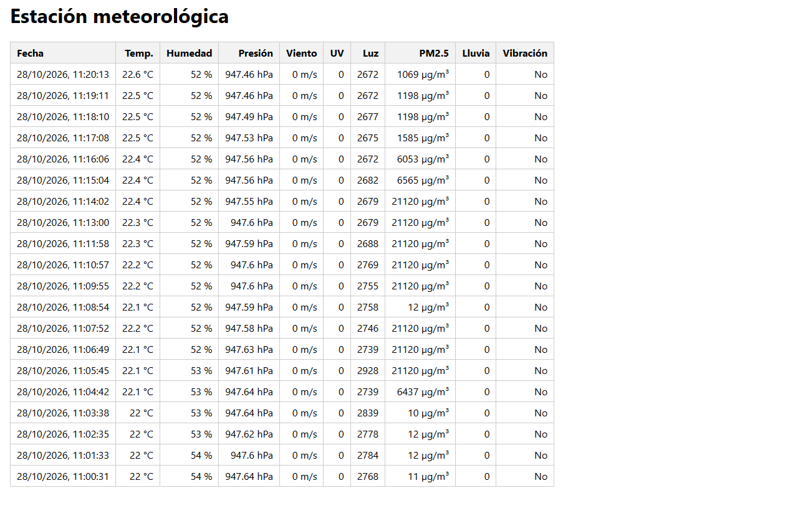
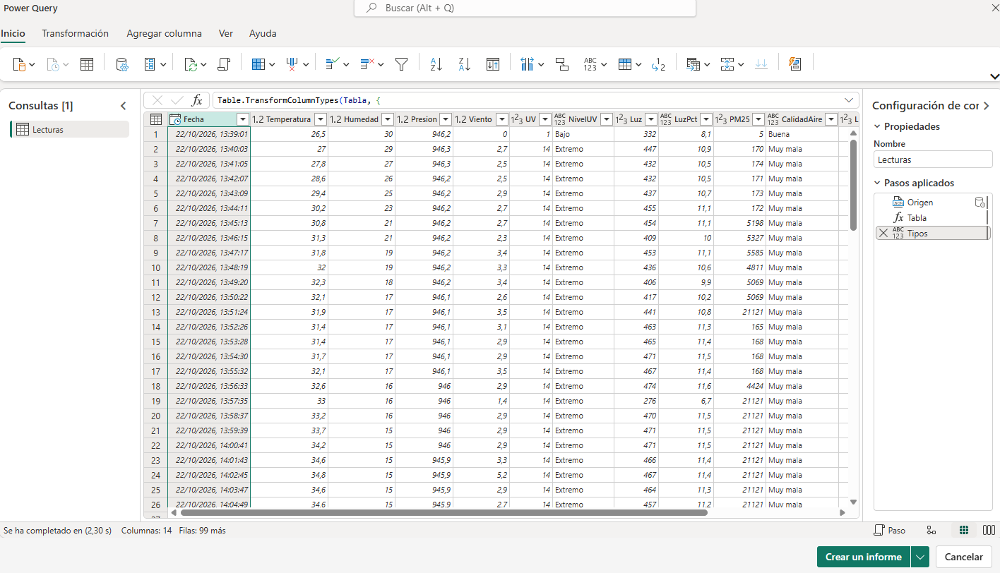
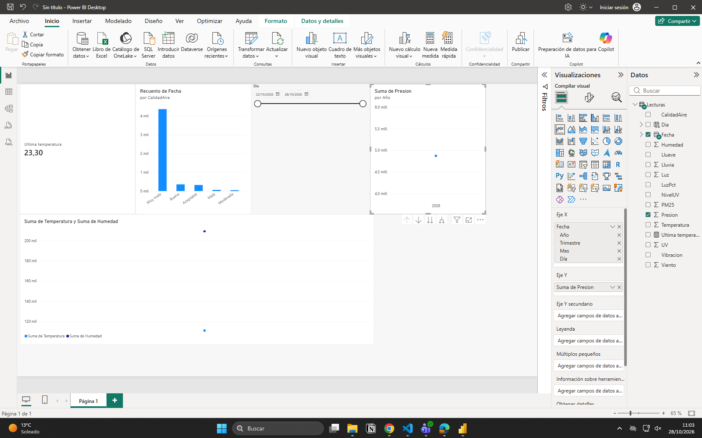

# Evidencias: Mini práctica - Datos de la estación meteorológica en Power BI

En este documento se recogen las evidencias paso a paso de la conexión y visualización de los datos de la estación meteorológica ACEBOTT.

## Parte A: Ver los datos en el navegador

Al acceder al enlace proporcionado por la API (ngrok), podemos observar la tabla en formato web con las últimas lecturas en tiempo real de la estación. 

**Lecturas en el navegador:**

## Parte B: Cargar los datos en Power BI

Utilizando Power BI Desktop, se ha creado una Consulta en blanco y se ha introducido el código M en el Editor avanzado para conectar con la API. Como se muestra a continuación, los datos se han importado y los tipos de columna se han asignado correctamente dentro del Editor de Power Query.

**Datos cargados y transformados en Power Query:**

## Parte C: El Reto (Dashboard final)

Una vez cargados los datos en el modelo, se han creado las columnas y medidas DAX solicitadas (como `Ultima temperatura` y `Dia`) y se han construido los siguientes objetos visuales en el lienzo del informe:

1. **Tarjeta:** Muestra la última temperatura registrada usando la medida DAX con `CALCULATE` y `MAX`.
2. **Gráfico de barras:** Muestra el recuento de filas (lecturas) agrupadas por la categoría de `CalidadAire`.
3. **Segmentador (Slicer):** Permite filtrar el informe utilizando la nueva columna calculada `Dia`.
4. **Gráficos de líneas:** Se incluyen las visualizaciones solicitadas para analizar la evolución de la Temperatura vs Humedad y el extra con la gráfica de la Presión atmosférica.

**Visualización final del informe:**
